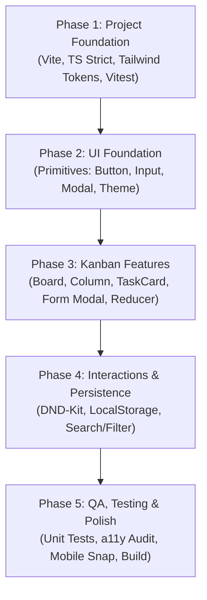

# IMPLEMENTATION_PLAN.md — MiniKanban Architecture & Execution Roadmap

This document defines the technical architecture, data model, component hierarchy, and phased execution plan for **MiniKanban**, adhering strictly to [AGENTS.md](AGENTS.md) and [DESIGN.md](DESIGN.md).

---

## 1. Architectural Overview & System Design

### 1.1 Directory & Folder Structure

```text
minikanban/
├── index.html
├── package.json
├── tsconfig.json
├── tsconfig.node.json
├── vite.config.ts
├── tailwind.config.ts
├── postcss.config.js
├── src/
│   ├── main.tsx                         # Application bootstrap
│   ├── App.tsx                          # Root layout, theme provider, board orchestrator
│   ├── index.css                        # Tailwind directives & CSS custom properties
│   │
│   ├── types/                           # Centralized domain types
│   │   ├── kanban.ts                    # Task, Column, Priority, Board, Filter types
│   │   └── theme.ts                     # Theme mode types
│   │
│   ├── constants/                       # Static definitions & seed data
│   │   ├── columns.ts                   # Default columns (To Do, In Progress, Done)
│   │   └── initialData.ts               # Initial sample tasks for first-time onboarding
│   │
│   ├── hooks/                           # Encapsulated state and business logic
│   │   ├── useKanbanBoard.ts            # Board state, task CRUD, reorder transitions
│   │   ├── useLocalStorage.ts           # Type-safe, validated localStorage persistence
│   │   ├── useTheme.ts                  # Light/Dark mode state and toggle
│   │   └── useTaskFilter.ts             # Search query & priority filtering logic
│   │
│   ├── components/                      # Modular UI components
│   │   ├── common/                      # Shared primitive components
│   │   │   ├── Button.tsx               # Primary, Secondary, Ghost, Icon button variants
│   │   │   ├── Input.tsx                # Text input with label & error message
│   │   │   ├── Textarea.tsx             # Multi-line input for task descriptions
│   │   │   ├── Modal.tsx                # Accessible dialog with focus trap & backdrop
│   │   │   ├── Badge.tsx                # Priority and status pill badges
│   │   │   └── ThemeToggle.tsx          # Light/Dark theme switcher button
│   │   │
│   │   ├── layout/                      # Application shell
│   │   │   ├── Header.tsx               # App logo, board title, stats, action bar
│   │   │   └── FilterToolbar.tsx        # Search input and priority filter pills
│   │   │
│   │   └── kanban/                      # Kanban domain components
│   │       ├── Board.tsx                # Multi-column grid container / scroll track
│   │       ├── Column.tsx               # Column container with header, card list & dropzone
│   │       ├── ColumnEmptyState.tsx     # Tactile placeholder for empty columns
│   │       ├── TaskCard.tsx             # Presentational task card (resting & active)
│   │       ├── TaskFormModal.tsx        # Create & edit task dialog
│   │       ├── TaskActionMenu.tsx       # Accessible keyboard move & delete dropdown
│   │       └── DragDropContext.tsx      # DND wrapper orchestrator
│   │
│   └── utils/                           # Pure helper functions
│       ├── storage.ts                   # Schema validation & error-safe JSON parsing
│       ├── array.ts                     # Immutable array reordering helpers
│       └── a11y.ts                      # Keyboard event handlers & ARIA utilities
│
└── tests/                               # Automated test suites
    ├── unit/
    │   ├── useKanbanBoard.test.ts       # Board state transitions & CRUD testing
    │   ├── storage.test.ts              # LocalStorage validation & fallback testing
    │   └── array.test.ts                # Card reorder computation unit tests
    └── components/
        ├── TaskCard.test.tsx            # Card rendering, priority badges, actions
        ├── Column.test.tsx              # Column task list & empty state rendering
        └── FilterToolbar.test.tsx       # Filtering & search interaction tests
```

---

## 2. Technical Decisions & Core Architecture

### 2.1 TypeScript Domain Data Model (`src/types/kanban.ts`)

```typescript
export type Priority = 'low' | 'medium' | 'high';

export type ColumnId = 'todo' | 'in-progress' | 'done';

export interface Task {
  id: string;
  title: string;
  description?: string;
  priority: Priority;
  columnId: ColumnId;
  createdAt: number;
  updatedAt: number;
}

export interface Column {
  id: ColumnId;
  title: string;
  description?: string;
}

export interface BoardState {
  version: number; // Schema migration tag (v1)
  tasks: Record<string, Task>; // Normalised dictionary for O(1) lookups
  columns: Record<ColumnId, string[]>; // Column ID -> Ordered array of Task IDs
}

export interface TaskFilter {
  searchQuery: string;
  priorityFilter: Priority | 'all';
}
```

### 2.2 State Management Strategy
* **Pattern:** Custom React Hook (`useKanbanBoard`) utilizing `useReducer` with pure transition functions.
* **Benefits:**
  * Predictable, deterministic state transitions (creating, editing, moving across columns, reordering within columns).
  * High testability without mounting DOM components.
  * Encapsulated domain logic completely detached from presentation components.
* **Normalized Data Structure:**
  * Tasks are keyed by `id` in `Record<string, Task>`.
  * Column ordering is stored as an array of IDs (`Record<ColumnId, string[]>`).
  * Prevents costly array scans on single-task edits and eliminates duplicate references.

### 2.3 Drag-and-Drop Library Decision
* **Selected Solution:** `@dnd-kit/core` + `@dnd-kit/sortable` + `@dnd-kit/utilities`
* **Justification against alternatives:**
  * **vs. Native HTML5 DnD:** Native DnD does not work on mobile touch devices without fragile polyfills; lacks built-in keyboard accessibility; styling dragging ghosts across browsers is notoriously inconsistent.
  * **vs. `@hello-pangea/dnd`:** Considerably larger bundle size (~45kb), relies on deprecated React DOM nodes, and has less flexible sensor customisation.
  * **`@dnd-kit` Advantages:**
    * **Modular & Lightweight:** Only import `@dnd-kit/core` and `@dnd-kit/sortable` (~12kb gzip).
    * **Touch & Pointer First:** Robust pointer and touch sensors with activation constraints (e.g. 3px movement or 150ms delay) to prevent accidental drags when tapping cards.
    * **First-Class Accessibility:** Built-in keyboard navigation sensors (`KeyboardSensor`) and ARIA live announcements.
    * **Visual Alignment:** Allows precise implementation of [DESIGN.md](DESIGN.md) requirements (1.2° tilt, subtle drop indicator, elevation changes).

### 2.4 LocalStorage Persistence & Validation Strategy
* **Storage Key:** `minikanban_state_v1`
* **Schema Versioning:** Every payload includes `version: 1`. Future schema updates can run non-destructive migration scripts.
* **Resilient Parsing:**
  * Pure validation function `validateBoardState(raw: unknown): BoardState` checks field types, presence of required column IDs, and array integrity.
  * If parsing fails or corrupted data is detected, it logs a warning, falls back cleanly to `initialData`, and preserves corrupted data in a backup key (`minikanban_backup_{timestamp}`).
* **Write Optimization:** State changes are synchronized to `localStorage` safely via a debounced or `useEffect` hook.

### 2.5 Accessibility (a11y) Architecture
* **WCAG 2.1 AA Compliance:** Verified contrast ratios per [DESIGN.md](DESIGN.md) (14.2:1 for body text, >4.5:1 for accents).
* **Keyboard Navigation:**
  * Every card is focusable (`tabindex="0"`).
  * Card context menu provides explicit keyboard actions: "Move to In Progress", "Move to Done", "Move Up", "Move Down", "Edit", "Delete".
* **Modal Accessibility:** `aria-modal="true"`, focus trap within the dialog, initial focus on the title input, restoration of focus on close, and dismiss on `Escape`.
* **Reduced Motion:** Respects `prefers-reduced-motion` to disable transforms, transitions, and dragging tilts.

### 2.6 MVP Boundaries (Anti-Scope-Creep)

| In-Scope (MVP) | Explicitly Out-of-Scope (Deferred) |
| :--- | :--- |
| Single board with 3 fixed columns (To Do, In Progress, Done) | Custom column creation, renaming, or deletion |
| Task title, optional description, priority (Low/Med/High) | Rich text / Markdown editor, subtasks / checklists |
| Drag-and-drop between & within columns | Multiple separate boards |
| Keyboard move alternative menu | Real-time backend sync / WebSockets |
| Client-side search & priority filter | User authentication or multi-user collaboration |
| LocalStorage persistence & validation | Cloud storage / server database |
| Light and Dark theme (Stone & Sage) | Custom color themes / background wallpaper |
| Mobile responsive swipe & touch targets | Mobile native push notifications |

---

## 3. Five-Phase Implementation Roadmap

---

### Phase 1: Project Foundation

#### Objective
Scaffold the base React + TypeScript + Vite project within `feat-initial-app`, configure Tailwind CSS with custom design tokens, and establish the testing and linting harness.

#### Files & Components
* `package.json`: Dependencies (`react`, `react-dom`, `@dnd-kit/core`, `@dnd-kit/sortable`, `@dnd-kit/utilities`, `clsx`, `tailwind-merge`, `lucide-react`) and dev dependencies (`vite`, `typescript`, `tailwindcss`, `postcss`, `autoprefixer`, `vitest`, `@testing-library/react`, `@testing-library/jest-dom`, `eslint`).
* `tsconfig.json` & `tsconfig.node.json`: TypeScript strict mode enabled (`"strict": true`, `"noImplicitAny": true`).
* `vite.config.ts`: Vite setup with Vitest configuration.
* `tailwind.config.ts`: Custom color tokens (`bg-canvas`, `accent-sage`, etc.), fonts, and shadow scales matching [DESIGN.md](DESIGN.md).
* `src/index.css`: Tailwind directives, base font smoothing, root CSS variables for light/dark mode.
* `src/types/kanban.ts` & `src/types/theme.ts`: Base domain contracts.

#### Key Tasks
1. Initialize Vite + React + TypeScript configuration.
2. Configure Tailwind CSS with the exact token scale defined in `DESIGN.md`.
3. Set up Vitest and React Testing Library test runner.
4. Define domain TypeScript models with strict type enforcement.

#### Acceptance Criteria
* `npm run build` succeeds without warnings.
* `npx tsc --noEmit` passes with zero type errors.
* `npm test` runs and executes sample test cleanly.

#### Verification Commands
```bash
npm run build
npx tsc --noEmit
npm test
```

#### Dependencies
None.

---

### Phase 2: UI Foundation & Design System Primitives

#### Objective
Implement reusable, accessible UI primitives matching the warm editorial identity from [DESIGN.md](DESIGN.md) (buttons, inputs, modal dialogs, badges, theme toggle, and main app header).

#### Files & Components
* `src/components/common/Button.tsx`: Variants (`primary`, `secondary`, `ghost`, `icon`) with active press scale and focus ring.
* `src/components/common/Input.tsx`: Form input with focus state, label, and accessible error message.
* `src/components/common/Textarea.tsx`: Multi-line text area for descriptions.
* `src/components/common/Badge.tsx`: Priority pills (`low`, `medium`, `high`) using terracotta, amber, and stone tokens.
* `src/components/common/Modal.tsx`: Accessible dialog component with focus lock, escape-key handler, and backdrop blur.
* `src/components/common/ThemeToggle.tsx`: Toggle button with icon for light/dark theme.
* `src/hooks/useTheme.ts`: LocalStorage-persisted theme switcher updating `document.documentElement.classList`.
* `src/components/layout/Header.tsx`: Top bar with title, stats summary, theme toggle, and "+ New Task" trigger.

#### Key Tasks
1. Build primitive components following strict props typing and zero unnecessary dependencies.
2. Implement accessible modal dialog with ARIA attributes and focus trapping.
3. Implement theme toggle hook respecting system preference and manual user override.
4. Verify all components against [DESIGN.md](DESIGN.md) color contrast and sizing specs.

#### Acceptance Criteria
* All interactive elements have visible `focus-visible` states (`ring-2 ring-[#3D5A45]`).
* Theme toggle switches `dark` class seamlessly on `<html>` with persisting state.
* Dialog opens, traps focus, and closes on `Esc` or backdrop click.

#### Verification Commands
```bash
npx tsc --noEmit
npm test
```

#### Dependencies
Phase 1.

---

### Phase 3: Kanban Feature Implementation

#### Objective
Build the core Kanban board layout, column containers, task cards, and task creation/editing flows without drag-and-drop.

#### Files & Components
* `src/constants/columns.ts`: Definitions for `todo`, `in-progress`, `done`.
* `src/constants/initialData.ts`: Realistic sample tasks demonstrating low, medium, and high priorities.
* `src/hooks/useKanbanBoard.ts`: Reducer managing `ADD_TASK`, `EDIT_TASK`, `DELETE_TASK`, `MOVE_TASK`.
* `src/components/kanban/Board.tsx`: Main board layout (horizontal flex on desktop, snap-scroll on mobile).
* `src/components/kanban/Column.tsx`: 300px column with count badge, card list, and empty state.
* `src/components/kanban/ColumnEmptyState.tsx`: Tactile placeholder with quick "+ Add task" trigger.
* `src/components/kanban/TaskCard.tsx`: Task card displaying priority badge, title, description preview, and action menu.
* `src/components/kanban/TaskFormModal.tsx`: Controlled dialog for creating and editing tasks.
* `src/components/kanban/TaskActionMenu.tsx`: Accessible menu for quick editing, deletion, and manual column moves.

#### Key Tasks
1. Implement `useKanbanBoard` hook with full unit tests for state actions.
2. Construct presentational `TaskCard` adhering to [DESIGN.md](DESIGN.md) spacing, typography, and card hierarchy.
3. Build `Column` container with header count badge and scrollable card area.
4. Wire up task creation and editing modals with validation (e.g. non-empty title).

#### Acceptance Criteria
* User can add a new task to any column via the modal.
* User can edit an existing task's title, description, or priority.
* User can delete a task with a confirmation safeguard.
* User can move tasks between columns using the card's accessible action menu.
* Empty columns render a clean, tactile empty state.

#### Verification Commands
```bash
npx tsc --noEmit
npm run test -- tests/unit/useKanbanBoard.test.ts
npm run build
```

#### Dependencies
Phase 2.

---

### Phase 4: Interactions, Drag-and-Drop & Persistence

#### Objective
Add tactile drag-and-drop interactions across columns and within columns, full LocalStorage persistence with schema validation, and real-time search/filter capabilities.

#### Files & Components
* `src/components/kanban/DragDropContext.tsx`: `@dnd-kit` orchestrator managing sensors (Pointer + Keyboard).
* `src/utils/storage.ts`: LocalStorage validation, error handling, and serialization functions.
* `src/hooks/useLocalStorage.ts`: Hook for debounced state synchronization.
* `src/hooks/useTaskFilter.ts`: Search query string and priority filter hook.
* `src/components/layout/FilterToolbar.tsx`: Search input box and priority filter pills (`All`, `High`, `Medium`, `Low`).
* `src/components/kanban/TaskCard.tsx`: Integrates `@dnd-kit/sortable` `useSortable` hook with 1.2° drag tilt styling.

#### Key Tasks
1. Integrate `@dnd-kit` sensors:
   * Pointer sensor with `activationConstraint: { distance: 3 }` to allow card clicks.
   * Keyboard sensor for accessible keyboard drag-and-drop.
2. Implement cross-column and intra-column drag handlers with immediate optimistic UI updates.
3. Implement `FilterToolbar` allowing users to filter tasks by title/description and priority tag in real time.
4. Wire `useLocalStorage` to persist changes immediately; add graceful fallback if storage is disabled or quota exceeded.

#### Acceptance Criteria
* Tasks can be dragged and dropped between columns and reordered within the same column smoothly.
* Dragging displays tactile elevation (`shadow-xl`) and tilt without layout thrashing.
* Search filter filters cards in real time; clear empty state shows when no tasks match query.
* Board state survives page reload through `localStorage`.

#### Verification Commands
```bash
npx tsc --noEmit
npm test
npm run build
```

#### Dependencies
Phase 3.

---

### Phase 5: Quality Assurance, Testing & Polish

#### Objective
Audit accessibility, implement unit and integration test suites, verify responsive behaviors on mobile viewports, and audit against web-design-guidelines and react-best-practices.

#### Files & Components
* `tests/unit/storage.test.ts`: Test corrupted storage recovery, fallback to seed data.
* `tests/unit/array.test.ts`: Test immutable array reordering math.
* `tests/components/TaskCard.test.tsx`: Test card renders priority badges, handles clicks.
* `tests/components/Column.test.tsx`: Test column task counts and empty state.
* `tests/components/FilterToolbar.test.tsx`: Test search filtering and priority toggling.
* `src/App.tsx`: Final integration check, layout polish, and error boundary safeguard.

#### Key Tasks
1. Complete automated test suites for domain logic, storage safety, and UI components.
2. Perform mobile responsive audit: verify snap-carousel behavior and min-44px touch targets.
3. Perform accessibility audit: verify keyboard tab sequence, ARIA labels, and color contrast.
4. Run production build verification (`npm run build`) and ESLint.

#### Acceptance Criteria
* 100% of automated tests pass cleanly.
* `npm run lint` and `npx tsc --noEmit` pass with zero warnings/errors.
* Production bundle builds cleanly with optimal bundle size (< 150kb gzip).
* Fully operational in both Light (warm off-white) and Dark (quiet charcoal) themes.

#### Verification Commands
```bash
npm run lint
npx tsc --noEmit
npm test -- --run
npm run build
```

#### Dependencies
Phases 1–4.

---

## 4. Execution Sequence Summary



---

## 5. Review & Verification Criteria

Before proceeding to implement any code, each phase will be executed in sequence. Every step must verify:
1. **Type Safety:** Clean compilation with zero TypeScript errors.
2. **Design Fidelity:** Faithful translation of [DESIGN.md](DESIGN.md) warm editorial palette and tactile feedback.
3. **Operational Discipline:** Explicit user approval before running execution commands, creating new files, or making structural changes.
